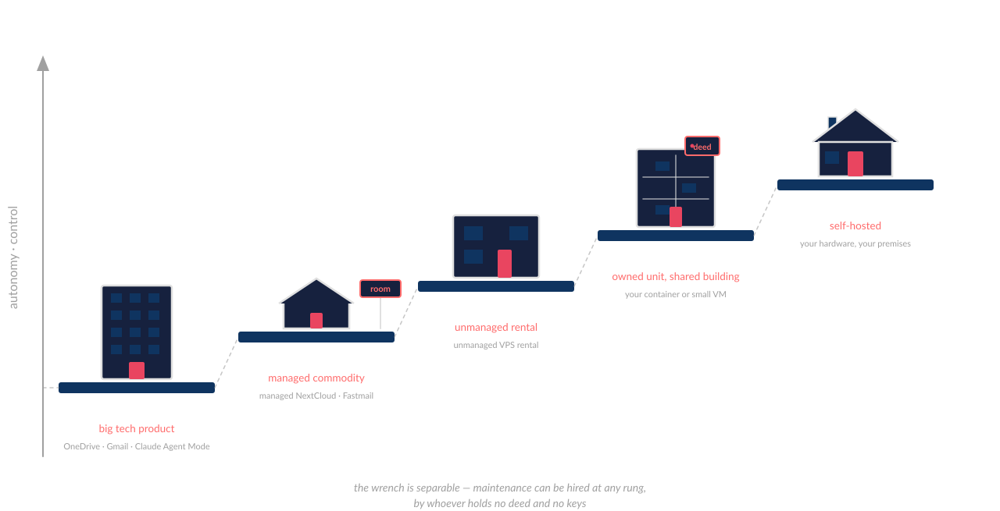
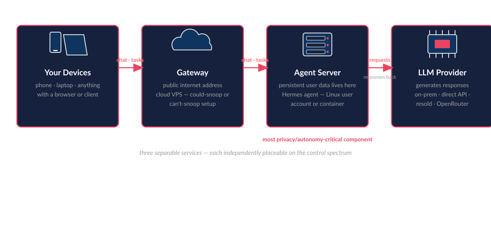

## What This Deck Is {.smaller}

An internal concept document: the **design space** for Kunguru's AI
assistant product, and the principle we use to navigate it.

> The goal is that everyone working on the project can answer: *what are we
> building, what tradeoffs define it, and why this option rather than that one?*

The long-form notes are in `notes/kunguru-concept-notes.md`. This deck is the
map, not the territory — and where it shows candidate starting points, it
**deliberately does not crown one**.

::: {.notes}
Set expectations: this is not a pitch deck. Audience is people building the
product. The housing metaphor gives us shared vocabulary; the autonomy
principle is the decision procedure; the technical sections enumerate the
actual options in the design space.
:::

# Part 0 — The Frame

## Assistants Are Becoming Infrastructure {.smaller}

An AI assistant is not an app you use. It is:

- a **persistent** agent you chat with from **any of your devices**,
- that **does things for you** — scheduled tasks, maintaining private or
  public custom web sites and applications,
- that accumulates **your context, history, and access** over time.

::: {.fragment}
That makes it **infrastructure** — something you depend on daily, like email
or your website.

> Losing access, or being locked out, is a *big problem* — not an
> inconvenience.
:::

::: {.notes}
The persistence is the key property. An assistant is not a stateless tool;
it is a growing repository of your data and delegated capability. That is
why where it lives matters in a way it never did for, say, a calculator app.
:::

## Today's Assistants Are Dorms {.smaller}

The assistants people can actually get today — Microsoft OneDrive, Gmail,
Claude Agent Mode, Grok Agent, and friends — are all **big-tech hosted**.

::: {.fragment}
That means they come with the full dorm package:

- rules about what you can do,
- surveillance as a default operating condition,
- eviction risk with no alternative provider.
:::

::: {.fragment}
> The question is not *whether* to have an assistant. It is: **who controls
> where it lives and what it may do?**
:::

::: {.notes}
Name the current offerings explicitly — they are the incumbent. Don't argue
they are evil; argue they are dorms. The problem is structural (who holds
the powers), not about any particular company's behavior.
:::

# Part 1 — The Vocabulary: Five Levels of Control

## Where Your Software Lives Is a Housing Decision {.smaller}

Every hosting arrangement sits somewhere on one spectrum — **control versus
convenience** — and every point on it has a housing analogue.

{height=540px}

::: {.notes}
Five rungs, not four — the condo between apartment and house is a real
tenure, not a variant of either. This figure is the shared vocabulary for
every tradeoff discussion in the project: "that's a dorm solution," "that's
a condo problem." Note the bottom annotation: maintenance is separable from
the ladder — that becomes a slide of its own shortly.
:::

## Who Holds Which Layers {.smaller}

The ladder is really about **which layers of the stack you hold**:

| Rung | You hold | Others hold |
|---|---|---|
| Dorm | nothing — an account | the whole building, your room, the rules |
| Boarded room | your **data** (suitcase = backups) | the house — including your room |
| Apartment | data + **software** (the interior) | the building shell; entry with notice |
| Condo | your **unit** — container, data, software | land + common areas; association CC&Rs |
| House | everything, incl. hardware and connectivity | nothing |

::: {.fragment}
> Every layer someone else holds is a layer they can **rule**, a layer they
> can **watch**, a layer they can **take away** — and a layer they must
> **maintain**.
:::

::: {.notes}
The four powers in the governing sentence are the four columns of every
rung slide that follows: rules, observation, eviction, maintenance. The
condo row is the one the old four-rung ladder had no home for: you hold a
deed to a unit inside infrastructure you don't own.
:::

## Rung 1: Big Tech Product = College Dorm {.smaller}

Microsoft OneDrive, Gmail, Claude Agent Mode, Grok Agent, etc.

- There are **rules** about what you can do.
- If you break the rules — even **inadvertently** — you may get kicked out.
- If you get kicked out, that's a **big problem**: nobody else provides dorms
  for this college.
- You're being **watched** most of the time. There's definitely a record of
  when you card into the door, and there are people who can easily get it.

::: {.fragment}
Advantage: if the toilet clogs, there's a **maintenance person**.

Maybe advantage: you've got a **non-optional meal plan**.
:::

::: {.notes}
The meal plan line is deliberate — dorm food is convenient and also not a
choice. Note the eviction asymmetry: the cost of being kicked out is
magnified by the lack of alternatives, which is exactly what lock-in means.
:::

## Rung 2: Managed Commodity = Boarded Room {.smaller}

Managed NextCloud, Fastmail, Hermes from a VPS provider, etc.

Like renting a room in someone's house: it's **your room and your key**, but
it's **their house**.

- There are still **house rules**.
- The owner maintains everything — **and can enter your room**. You're still
  being watched most of the time; still card-scan records for all the doors.
- If you get kicked out **and have backups**, you can reasonably move to
  another basically similar room — your **suitcase**, not the room.

::: {.fragment}
The upgrade over the dorm is **portability, not privacy**: same owner-tenant
structure, but the exit door actually leads somewhere.
:::

::: {.notes}
Backups are doing all the work here — the suitcase. The boarding-room frame
replaces the old long-stay hotel: a hotel is transient lodging, nobody's
home; a rented room is a real tenure that maps cleanly. The "still watched"
parallel to the dorm is explicit and intentional.
:::

## Rung 3: Unmanaged Rental = Rented Apartment {.smaller}

Unmanaged commodity server rental, physical or virtual.

- The rules tend to be limited to **risks to the provider / other tenants**.
- If you have backups, you can drop them straight into **any other provider**.
- Disadvantage: routine **toilet clogs and dead light bulbs are your
  problem**. Any software issues are your problem.
- Advantage: if the heat fails, you can **call the landlord**.
- The landlord **can enter and inspect** your apartment — typically with
  restrictions.

::: {.notes}
This is the rung where most "self-hosting" projects actually live in
practice, and where they die: the maintenance burden is fully yours. The
landlord-can-enter point matters later for the gateway discussion.
:::

## Rung 4: Shared Server = Condo {.smaller}

Per-user **agent containers or small VMs** on a shared server — for teams,
and for individuals who want **shared-hosting economics with isolation**.

- **A deed, not a lease** — you own the unit: your container, your data,
  your software, your rules inside. Nobody non-renews you.
- **The association governs the building, not your unit** — CC&Rs = usage
  policy (the "risks to the building" rules). Your unit requires *your*
  permission — or a warrant.
- **HOA dues = the economics** — building, power, network, and common
  maintenance amortized across units.
- **The walls are the product** — containers are framed walls; small VMs are
  concrete.

::: {.fragment}
You can **sell and move**: export the whole *running* unit and stand it up
elsewhere — the running stack, not just backups.

Two flavors: individuals on a Kunguru-operated server (**we** are the
association) — or a group that has formed its **own org** and we help *them*
set up *their* infrastructure (**they** are the association; we're the hired
architect). The second is the especially interesting case.
:::

::: {.notes}
The old ladder had no home for this rung, and it's the one that covers
"economics of shared hosting plus isolation." Note the bounded rule power:
an association enforces CC&Rs and dues — it cannot non-renew you. Governance
flavors matter for market surveys: Kunguru-as-association creates dependence
on us (labeled honestly in Part 3); org-as-association makes us a contractor.
:::

## Rung 5: Self-Hosted = Owned House {.smaller}

A server in your own home or business means you fully own it.

- Nobody can enforce rules **beyond the actual laws**. Full freedom of
  speech, freedom of association; searches require a **warrant**.
- If it breaks, you fix it yourself — or hire the **professional of your
  choice**.
- Disadvantage: you need to provide **connectivity yourself**.

::: {.notes}
The warrant line is the crisp legal expression of the autonomy difference:
at the lower rungs, the operator can look at your stuff whenever their terms
allow it. At the house rung, an external party needs state power to look.
The "professional of your choice" phrase is load-bearing — it sets up the
next slide.
:::

## The Bundling Question: Deed, Keys, and Wrench {.smaller}

Every arrangement distributes three powers — and differs in **whether one
entity holds them all**:

| Rung | Deed + keys (rule, evict, watch) | Wrench | Bundled? |
|---|---|---|---|
| Dorm | the institution | the institution (it also feeds you) | **fully** |
| Boarded room | the landlady | the landlady | **fully** |
| Apartment | landlord — entry rights, structural rules | landlord for structure; **you** for interior | partially |
| Condo | you (unit) + association (bounded: CC&Rs, dues) | association (common areas); you (interior) | **split by design** |
| House + support contract | **you** | yours — or **hired** | **not at all** |

::: {.fragment}
**Maintenance is bundled with control exactly as far as someone else holds
your deed — and unbundled the moment you do.**

The house's freedom isn't DIY plumbing; it's that **the plumber has no power
over you**.
:::

::: {.notes}
This is the slide that answers "is maintenance bundled with ownership /
eviction power?" Dorms and Grok Agent: yes, one hand. Privately owned house
with no HOA, or Kunguru selling a physical server with open-source software
and a support contract: clearly not. The condo is the designed split.
:::

## The Pattern: Two Questions, Not One {.smaller}

Every arrangement answers two **independent** questions:

1. **Which powers do others hold over you?** — rules (deed), observation
   (keys), eviction.
2. **Is the wrench bundled with those powers?** — or is maintenance hired,
   separable, and terminable?

::: {.fragment}
The dorm's signature isn't bad rules — it's **one hand holding the deed, the
keys, and the wrench**.
:::

::: {.fragment}
> **Kunguru sells the wrench separately from the keys.** A support contract
> carries no tenure power and no observation power. Dependence on us is
> contractual and terminable — never structural.
:::

::: {.notes}
This is the product philosophy in one slide. Kunguru's product exists in the
gap these two questions open up: any rung whose wrench is separable is a
place we can work.
:::

# Part 2 — The Principle

## Autonomy Is the Value; Privacy Is a Special Case {.smaller}

The housing ladder is really an **autonomy ladder**. Autonomy has three
tests:

1. **Can you say no?** — to rules, terms, "features," content policies.
2. **Can you leave?** — without losing the thing, and without permission.
3. **Can you take it with you?** — your data, your history, your identity.

::: {.fragment}
> **Privacy is autonomy where the threat is observation rather than
> control.** Surveillance is a landlord problem, not a separate category.

So we don't treat privacy as its own goal — we treat it as one consequence
of the user actually owning the thing.
:::

::: {.notes}
This is the hinge of the whole deck and the decision procedure for the
whole design space. When two options are otherwise equal, we take the one
that passes more of the three tests.
:::

## Vendor Dependence Is the Risk Side of Autonomy {.smaller}

"Can you leave?" hides a sub-question: **independent of which vendor, and at
what exit cost?**

Every provider you depend on is **risk you carry**: their solvency, their
incentives, their terms, their upstream relationships.

::: {.fragment}
So for every configuration, we ask — explicitly, in the deck:

- Who are the vendors? **Kunguru, a commodity vendor, big tech?**
- Is the customer **independent of us, or dependent on us?**
- Are we **reselling**? If so, we've inserted ourselves into their
  dependency chain.
:::

::: {.fragment}
> Autonomy is to independence as **vendor dependence is to risk**.
:::

::: {.notes}
This slide exists because the rungs alone hide the vendor question. The
opposite of autonomy-through-vendor-independence is vendor dependence as
risk — and we want to be on record naming which vendor the customer is
independent of or dependent on, especially when the vendor is us.
:::

## Why Autonomy Matters More for Assistants {.smaller}

An assistant is not email. It is a **delegate**:

- it **acts** — schedules, publishes, transacts, maintains sites — in your name,
- it holds an **accumulating memory** of everything you've asked and done,
- it has **access**: your accounts, your files, your voice.

::: {.fragment}
Whoever hosts your assistant holds your delegate: its memory, its access,
its voice.

> Dorm rules bite **harder** when the thing being ruled does things *for*
> you, with your identity attached.
:::

::: {.notes}
This is why the assistant category is different from prior autonomy fights
(email, files). The eviction and surveillance risks scale with the agent's
capability. A locked email account is bad; a locked delegate that controls
your public presence is worse.
:::

# Part 3 — The Product

## What Kunguru Provides {.smaller}

**AI assistants for individuals, teams, and groups** — with entirely
non-big-tech infrastructure, configurable across the control spectrum
depending on user needs.

An assistant is:

- a **persistent agent** you chat with from any of your devices,
- running **Hermes Agent** plus our scaffolding for custom web apps,
- able to **do things for you**: scheduled tasks, and maintaining private or
  public custom web sites / applications.

::: {.notes}
Keep this concrete: the product is Hermes Agent + the app scaffolding + the
deployment story. "Entirely non-big-tech" refers to the platform — the agent
server, gateway, and web-app hosting are not a big-tech product. The LLM
sourcing is deliberately flexible (Part 4).
:::

## Two Deployment Cases {.smaller}

Everything in the design space is organized around two cases:

| | Single isolated user | Team |
|---|---|---|
| **Who** | one person, their assistant | multiple users, each with their own assistant |
| **Also** | — | assistants and users **working together** |
| **Condo option** | shared economics + isolation, no hardware | natural fit — esp. orgs that group into their own entity |
| **Rung targets** | any rung from boarded room to house | condo or house |

::: {.notes}
These are the two columns every option in Part 4 gets evaluated in. The
team case adds coordination between assistants, but each user still owns
their own. The condo row is the survey-menu item from Part 1.
:::

## The False Binary We Avoid {.smaller}

The market offers two assistants:

::: {.fragment}
**The dorm** — capable, maintained, surveilled, rule-bound, inescapable.
:::

::: {.fragment}
**The cabin in the woods** — raw unmanaged everything: full control, full
maintenance burden, expert-only.
:::

::: {.fragment}
> Kunguru's position: **managed autonomy** — we do the plumbing; the user
> holds the deed. Any rung whose wrench is separable is a place we can work.

We support a range of configurations depending on user needs — the product
slides along the ladder instead of picking one rung and defending it.
:::

::: {.notes}
"Managed autonomy" is now precise rather than slippery: it means selling the
wrench without the keys. Note this does not crown a rung — the boarding
room, apartment, condo, and house are all in scope.
:::

## Which Vendor Is Kunguru, in Each Configuration? {.smaller}

| Configuration | Kunguru's role | Dependence on us | Exit |
|---|---|---|---|
| House: box + OSS + support contract | Hardware seller + support contractor | **Contractual only** — no keys, no deed | Fire us; hire anyone; self-maintain |
| Condo: *your org's* infrastructure | Architect/ops contractor to your association | Bounded by contract; you can re-contract | Hire another operator |
| Condo: Kunguru-operated shared server | **The operator — the association** | **Real**: building, gateway, maybe resold LLM | Unit export; component separation |

::: {.fragment}
Two disclosure rules:

1. **When we resell, we insert ourselves into the customer's dependency
   chain** — their risk now includes *our* relationship with the upstream
   vendor. Say where it's true.
2. **Mark plainly where the customer depends on Kunguru.** The mitigation
   stack — unit export, data portability, separable components, open
   source — only reads as credible if we admit the dependence first.
:::

::: {.notes}
This is the honesty slide. In the first row we are a vendor the customer is
independent of; in the third we are the vendor they depend on. Both are
valid products — but only if labeled. Also note the middle row: helping
users who have grouped into a separate org set up their infrastructure —
we're the hired architect, the association is theirs.
:::

# Part 4 — The Design Space

## An Assistant Is Three Separable Services {.smaller}

The reason Kunguru can slide along the ladder: an assistant decomposes into
**three components, each independently placeable**.

{height=440px}

::: {.notes}
This decomposition is the fundamental design decision. Big-tech assistants
are all three fused into one opaque service, which is *why* they are dorms.
Separating them is what lets the user own the state while renting the
intelligence. Each of the next three slides takes one box and enumerates its
options.
:::

## Own the State, Rent the Intelligence {.smaller}

The three components are not equally precious:

- The **model is stateless and fungible** — intelligence is a commodity
  input, swappable at will.
- The **agent server's memory, history, and access are the asset** — they
  accumulate, they are yours, and losing them is losing the assistant.

::: {.fragment}
> Autonomy concentrates in the **agent server**. Intelligence is deliberately
> a thin, replaceable dependency.

This is why "we avoid big-tech lock-in" is honest about the platform and
flexible about the model: own the state, rent the intelligence.
:::

::: {.notes}
Lock-in lives in the state, not in the model. A model swap is configuration;
a state migration is a crisis. This is an architectural claim about where
value sits — not a claim about which configuration we should lead with.
:::

## Dimension 1: The Agent Server {.smaller}

Something like the Hermes agent wants a **Linux user account or container**.
This is the **most privacy/autonomy-critical component** — it is where user
data lives persistently.

| Placement | Rung | Notes |
|---|---|---|
| On-prem mini PC (1–4 users) | house | plausibly a **$100** unit, at least for initial testing |
| Bigger on-premises machine | house | for more users / heavier load |
| Team server, single-tenant | house (org-owned) | the org holds the deed |
| Shared server, per-user containers/VMs | **condo** | shared economics + isolation; the survey-menu option |

::: {.notes}
The agent server is where the "house" lives. The $100 mini-PC number is the
anchor for the single-user case — cheap enough to be an appliance. The condo
row is where the interesting isolation engineering is: container walls vs.
VM walls, and who the association is.
:::

## Dimension 2: The Gateway {.smaller}

Something needs a **public internet address** — and putting that on a local
network is hard. That's the gateway's only job.

- Natural placement: **cloud VPS**.
- With the simplest setup, the provider **could snoop traffic but probably
  won't**.
- It is also possible to set this up so the provider **can't snoop traffic**.
- If the agent server itself is in the cloud, **no gateway is needed** —
  the agent answers directly.

::: {.notes}
Key insight: the gateway sees traffic but ideally never holds state. The
trust question is purely about observation in transit. The can't-snoop
configurations are an open design question (Part 6) — enumerate them there.
:::

## Dimension 3: The LLM Provider {.smaller}

Something has to generate the responses. Five sourcing options, in order of
increasing user control:

| Option | Sees | Cost profile |
|---|---|---|
| Standard cloud API, direct | request/response **+ your identity** | cheap, metered |
| Resold (we proxy) | request/response, **not** end-user identity | cheap + markup |
| Double-indirect (e.g. OpenRouter) | fragments; requests spread across providers, so **no one has your whole history** | cheap + markup |
| Shared unmanaged cloud | traffic, plus tenancy risks | expensive unless shared by many users |
| On-premises | nothing external | **$2000+ hardware** to be useful |

::: {.notes}
Each step down the table buys autonomy with money or trust. The
double-indirect row is doing subtle work: OpenRouter spreads requests across
providers so no single external party holds the whole history. Pooling
on-prem LLMs across multiple users is genuinely interesting but complex to
set up — flagged in open questions.
:::

## Assembled: Stacks at Each Rung {.smaller}

The three dimensions compose. Example configurations:

| Rung | Agent server | Gateway | LLM |
|---|---|---|---|
| Dorm | big tech's | (fused) | big tech's |
| Boarded room | provider-managed Hermes | provider's | cloud API |
| Apartment | your VPS, your container | same VPS | cloud API, direct or resold |
| Condo | your container / small VM on a shared server | shared, or your own | shared pool, or your own |
| House | **your mini PC** | cloud VPS (could-snoop → can't-snoop) | your choice — OpenRouter, or $2k+ on-prem |

::: {.fragment}
> Kunguru's product is **configurable across the rows** — each of the bottom
> four is a valid configuration. Which rows we lead with is a market
> question (Part 6).
:::

::: {.notes}
The dorm row is included only to show what "fused" looks like: one provider
owns all three boxes, which is precisely the lock-in we're decomposing away
from. Note the deliberate absence of a conclusion here — the deck presents
the space; the survey picks the product.
:::

# Part 5 — Adjacent Space

## Portability: Assistants as Movable Identity {.smaller}

An assistant is conceptually similar to something the federated world
already knows:

- an **ActivityPub server, XMPP server, or RSS blog** gives a user a public
  identity on a shared server,
- and *should* be portable — an "I have moved" mechanism, or an independent
  identity concept.

::: {.fragment}
> An AI assistant is **portable in the same way — and potentially public in
> the same way.** "Can you take it with you?" is the third autonomy test,
> applied to identity itself.
:::

::: {.notes}
This connects the three autonomy tests back to the federation tradition.
We're not building the identity layer now, but the architecture must not
preclude it — that's the design constraint this slide actually imposes.
:::

## Identity Is Hard {.smaller}

One candidate: users hold **self-signed identity certificates** on a DHT or
blockchain.

- Identity is **hard**.
- Cryptographic identity is **extra hard** in the face of non-expert users.

::: {.fragment}
Status: **exploration, not commitment.** The near-term goal is only that the
assistant's data and configuration are exportable — portable in the backups
sense (boarded room) even before anyone solves identity.
:::

::: {.notes}
This deliberately deflates the blockchain-shaped temptation. Exportability
is achievable now; cryptographic identity is research. Keep them separate so
the achievable thing doesn't wait on the hard thing.
:::

# Part 6 — Where We Stand

## Candidate Starting Points — Deliberately Open {.smaller}

Three first-class configs. **This deck does not crown one**; which we lead
with is a market question.

| | Fully on-premises | On-prem agent + external LLM | Fully shared, per-user isolation |
|---|---|---|---|
| Agent server | your hardware | $100-ish mini PC | your container / small VM |
| LLM | yours ($2k+ on-prem) | cloud API, double-indirect where practical | shared pool, or your own |
| Gateway | none needed | cloud VPS | shared |
| Vendors | commodity hardware only | hardware + LLM provider | **the operator** (Kunguru, or your org) |

::: {.notes}
Fully on-premises is a config we take seriously — even if, in practice, it
mostly functions the way the triple-stack burger does: the anchor that makes
the middle options look reasonable. Shared hosting with isolation is on the
menu for market surveys, including the condo-for-user-orgs flavor where the
customers' own association holds the deed.
:::

## Open Questions {.smaller}

1. **Can't-snoop gateway setups** — what are they concretely, and what do
   they cost in latency/complexity?
2. **Pooling on-premises LLMs across users** — really interesting, kind of
   complex to set up. Worth a spike?
3. **The condo product** — container walls vs. VM walls; *who is the
   association* (Kunguru vs. the customer's own org); the isolation
   engineering underneath.
4. **Where we resell** — which dependency chains are we willing to insert
   ourselves into, and how do we disclose them per configuration?
5. **Identity/portability mechanism** — "I have moved" vs. cryptographic
   identity; the latter is hard, and extra hard for non-experts.

::: {.notes}
These are the live edges of the design space, pulled out of the notes'
hedges so they're visible. Each one is a real project decision, not a
rhetorical question.
:::

## The One-Liner {.smaller}

> ### Own the state. Rent the intelligence. Live at the rung you choose.

::: {.fragment}
An assistant is infrastructure. Infrastructure has a control spectrum.

We build assistants at the rungs the big-tech dorms won't offer — and we
sell the wrench without the keys.
:::
